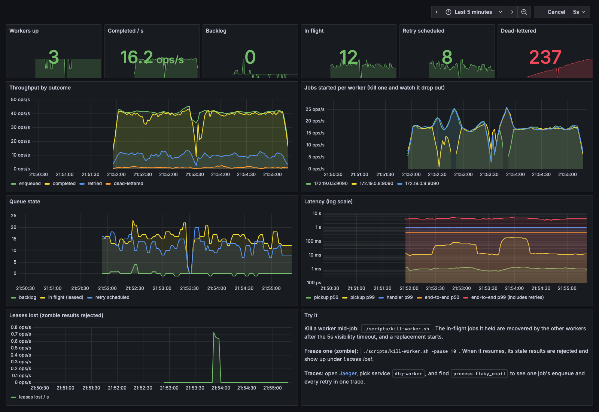

# Distributed Task Queue in Go

A distributed task queue on Redis Streams with worker pools, retries with exponential backoff, dead-lettering, lease-based crash recovery with heartbeats and fencing tokens, graceful shutdown, Prometheus metrics, and a fault-injection harness that checks the delivery guarantees hold while workers are killed and paused.

## Why Redis?

A broker is the durable system between code that enqueues work and workers that execute work. Without a broker, jobs usually live only in process memory. With Redis Streams, workers can share jobs across processes, acknowledge successful work, recover jobs abandoned by dead workers, and preserve enough state to make retries and dead-letter queues real.

This repo uses Redis Streams for the production-style backend. You can add an in-memory backend later for tests or learning, but the Redis backend is what makes the resume project more convincing.

## Architecture

```text
enqueue-demo / application code
        |
        v
   queue.Queue
        |
        v
 queue.Backend interface
        |
        v
 redisstream.Store            (one stream)
   or redisstream.Sharded     (N partitions, each a Store; see Sharding)
        |
        v
 Redis Streams + retry schedule + dead-letter stream
 (one Redis, or a Redis Cluster for Sharded)
        ^
        |
 queue.Worker -> registered task handlers
```

## Delivery Guarantees

Delivery is **at-least-once**. Every job ends up either completed (the handler returned nil *and* the ack landed) or in the dead-letter stream. No job is silently lost when workers crash, hang, or are shut down mid-job. A job can run more than once, so handlers must be idempotent. `Job.ID` is stable across retries and redeliveries, so handlers can use it as an idempotency key.

Every state transition (enqueue with an idempotency key, ack, retry, dead-letter, lease renewal, retry promotion, recovery) is a single Lua script in [redisstream/scripts.go](redisstream/scripts.go). A crash can't leave a job half-moved, and concurrent workers can't race each other.

| Failure | What happens | Mechanism | Proven by |
|---|---|---|---|
| Worker crashes mid-job | Job is re-delivered to another worker once its lease goes `VisibilityTimeout` without a heartbeat | `XAUTOCLAIM` in `recoverScript` | `TestRecoverExpiredRedeliversAndFencesOldLease`, `cmd/chaos` (SIGKILL) |
| Job runs longer than the visibility timeout | Lease is renewed while the handler runs, so it isn't stolen | Heartbeat → `extendScript` (`XCLAIM … JUSTID`) | `TestExtendPreventsRecovery`, `cmd/chaos` (jobs at 2× timeout) |
| Worker pauses (GC, VM freeze) and its lease is taken over | The zombie's ack/retry/dead-letter is rejected and its handler's context is cancelled | Fencing token = Redis delivery count, checked in every script | `TestRecoverExpiredRedeliversAndFencesOldLease`, `TestWorkerCancelsHandlerWhenLeaseIsLost`, `cmd/chaos` (SIGSTOP) |
| Crash between the handler's side effect and the ack | Job runs again (the at-least-once duplicate); the downstream applies the effect once | Downstream dedupes on the stable `Job.ID` | `cmd/chaos` (duplicate runs vs. effects) |
| Zombie applies a side effect after its lease was taken over | The downstream rejects it | `Job.FencingToken()`, checked by the downstream | `TestFencingTokenIncreasesAcrossRetriesAndRedeliveries`, `cmd/chaos` (SIGSTOP) |
| Producer retries an enqueue after a lost response | The retry returns the original job's ID instead of creating a second job | `EnqueueOptions.IdempotencyKey` → `enqueueOnceScript` | `TestIdempotentEnqueue`, `cmd/chaos` (10% of enqueues retried) |
| Crash between scheduling a retry and acking | Can't happen: both are one script | `retryScript` | — |
| Two workers promote the same due retry | Can't happen: promotion is one script | `promoteScript` | `TestConcurrentPromotionIsExactlyOnce` |
| SIGTERM while jobs are running | Worker stops claiming, lets in-flight jobs finish and ack, then exits (cancels them after `ShutdownTimeout`) | Handlers run on a context detached from the shutdown signal | `TestWorkerShutdownDrainsAndAcksInFlightJobs` |
| Redis blip | Worker backs off and keeps going instead of exiting | Exponential backoff in `Worker.Run` | `TestWorkerSurvivesTransientClaimErrors` |
| Job crashes or hangs every worker that runs it (poison message) | Dead-lettered after `MaxDeliveries` deliveries | Delivery count | `TestWorkerDeadLettersPoisonMessage` |
| No handler registered / malformed entry | Dead-lettered instead of stuck pending forever | `Worker.handleOne`, `Store.parseOrQuarantine` | `TestWorkerDeadLettersUnknownTask`, `TestMalformedEntryIsDeadLettered` |

### Exactly-once effects

Exactly-once *delivery* isn't achievable: a worker can always crash after doing the work but before reporting it. Exactly-once *effects* are, if the system receiving the side effect helps. Each run carries two values for it:

- `Job.ID`, stable across retries and redeliveries, as an idempotency key. The downstream applies each ID's effect at most once, which absorbs the redelivery after a crash between effect and ack.
- `Job.FencingToken()`, which increases with every retry and redelivery. The downstream rejects any write carrying a lower token than the highest it has seen for that job. That stops a paused zombie from applying a stale effect after its lease was handed to another worker. The queue's own fencing can't do this, because the effect has already left the process.

[cmd/chaos/downstream.go](cmd/chaos/downstream.go) is a working example: a downstream that does both checks in one Lua script. The chaos test checks every job's effect landed exactly once.

**Known limitations:** Redis is a single point of failure. With `appendfsync everysec`, a Redis crash can lose up to a second of acknowledged writes, and replication is asynchronous, so a failover can too.

## Chaos Testing

[cmd/chaos](cmd/chaos/main.go) enqueues a batch of jobs and runs several worker processes. While they work, it SIGKILLs a random worker (and starts a replacement), and SIGSTOPs workers for longer than the visibility timeout so they come back as zombies. It also sends 10% of enqueues twice, as a producer would after a lost response. Handlers record each run in a ledger and apply their side effect through a simulated downstream, and the harness then checks that:

- no job was lost (each one completed or was dead-lettered)
- permanent failures were dead-lettered and never completed
- the queue fully drained (nothing left in the stream, pending, or scheduled)
- every completed job's side effect landed exactly once

```sh
go run ./cmd/chaos                       # 10k jobs, 4 workers x 8, kill ~1/s, pause ~1/4s
go run ./cmd/chaos -jobs 20000 -workers 8 -kill-every 300ms
go run ./cmd/chaos -jobs 5000 -duration 15s -partitions 8   # sharded queue
```

Results with 5,000 jobs and 15s of faults (about 15 SIGKILLs and 3 pauses per run):

| | Before the fixes | After (12 runs) |
|---|---|---|
| Lost jobs | 159 | 0 |
| Stuck in the pending list | 173 | 0 |
| Permanent failures not dead-lettered | 4 | 0 |
| Duplicate runs | 426 | ~10–40 |
| Duplicate side effects | — | 0 |
| Zombie queue updates rejected | 0 (no fencing) | ~10–60 |
| Zombie side effects rejected by fencing | — | ~10 |

The remaining duplicate runs are the at-least-once cost: a worker died or was paused after the handler's side effect but before its ack. The downstream's idempotency and fencing checks keep them from becoming duplicate effects. The poison guard dead-letters a few of the jobs that outlive the visibility timeout, because their workers keep getting killed mid-run.

The sharded queue passes the same checks. In 4 runs with 8 partitions on one Redis and 1 with 16 partitions on a 3-node cluster: 0 lost, 0 duplicate side effects, and the queue fully drained, with 14–22 duplicate runs and 12–21 effects rejected by fencing, in line with the single stream.

## Performance

[cmd/bench](cmd/bench/main.go) measures throughput (enqueue a backlog of no-op jobs with `EnqueueBatch`, then time how long worker processes take to drain it) and pickup latency (enqueue to handler start, at a steady 200 jobs/s). Each worker is a separate process.

```sh
go run ./cmd/bench -modes block -workers 8 -concurrency 256                 # one Redis, one stream
go run ./cmd/bench -modes block -workers 8 -concurrency 256 -partitions 16  # one Redis, sharded
scripts/redis-cluster.sh start                                              # local 3-node Redis Cluster
go run ./cmd/bench -modes block -workers 8 -concurrency 256 -cluster 127.0.0.1:30001,127.0.0.1:30002,127.0.0.1:30003
```

### Scaling out with partitions

8 worker processes at concurrency 256, 500,000-job backlog, median of 3 runs. Redis 8.10.1 with persistence off, everything (Redis, workers, benchmark) on one 10-core M1 Max. Redis CPU is a share of one core, summed over nodes.

| setup | throughput (jobs/s) | Redis CPU | batched enqueue (jobs/s) | pickup p50 | pickup p95 | pickup p99 | machine CPU idle |
|---|---|---|---|---|---|---|---|
| one Redis, one stream | 95,470 | 99% | ~375,000 | 0.8ms | 1.8ms | 5–7ms | ~28% |
| one Redis, 8 partitions | 91,908 | 99% | ~283,000 | 0.3ms | 0.5ms | ~4ms | ~33% |
| one Redis, 16 partitions | 88,091 | 99% | ~206,000 | 0.2ms | 0.4ms | ~4ms | ~33% |
| 3-node cluster, 16 partitions | 123,125 | 167% (busiest node 69%) | ~382,000 | 0.2ms | 0.4ms | ~4ms | ~4% |

- **One Redis tops out near 95k jobs/s, and it's Redis that stops it.** Redis runs commands on one thread, and it sits at 99% of a core while a third of the machine is idle. Per-worker concurrency (the claim batch size) is the lever that gets it there: at concurrency 16 the same setup does ~50k jobs/s, with Redis just as busy but doing more round trips per job.
- **Sharding a single Redis costs a little.** Partitions on one Redis share the same thread, and each one adds its own claim calls and smaller per-partition batches. Throughput drops 4–8%, and enqueue drops more because a 100-job batch becomes 8 or 16 small transactions.
- **On a cluster, partitions spread the work across Redis processes: +29%.** No node goes above ~70% of a core, so Redis isn't the limit any more. The laptop is: with ~96% of its CPU in use, the 3 Redis nodes and 8 worker processes are competing for the same 10 cores. Running 4, 6, or 12 workers instead gave 113k–127k jobs/s. This setup can't show how far a cluster scales. That needs workers on their own machines, and Redis nodes on separate cores or hosts.
- **Pickup latency is under a millisecond everywhere.** The gap between 0.8ms and 0.2ms is mostly CPU power management, not the design. With one background process keeping a core busy, the single-stream setup also measures 0.3ms p50. More partitions mean more blocked reads and more wakeups, which keeps the cores out of deep idle.

### Claim modes

An earlier run (Redis 8.6, 16 concurrent jobs per worker, before batched claims and heartbeats) compared polling with blocking claims:

| claim mode | workers | throughput (jobs/s) | pickup p50 | pickup p95 | pickup p99 |
|---|---|---|---|---|---|
| poll | 1 | 14,988 | 48.0ms | 100.6ms | 105.4ms |
| poll | 8 | 40,319 | 40.1ms | 92.6ms | 99.7ms |
| block | 1 | 14,911 | 0.9ms | 2.7ms | 7.7ms |
| block | 8 | 39,853 | 1.1ms | 3.7ms | 8.9ms |

- **Blocking claims fix latency, not throughput.** Polling workers sleep up to `PollInterval` (100ms here) when the queue is empty. Blocking in `XREADGROUP` picks a job up as soon as it's enqueued. Under a backlog both modes are equally fast, since neither sleeps.
- **Group-committed acks raised throughput ~25–30%.** Acks that arrive while a batch is in flight go out together in one Lua call. At low load each batch has one ack, so it costs no latency. Lease heartbeats are batched the same way.

## Sharding

`redisstream.Sharded` splits a queue into N partitions so it can spread over a Redis Cluster. Each partition is an ordinary `Store` whose keys share a cluster hash tag: `dtq:{p3}:jobs`, `dtq:{p3}:retry`, `dtq:{p3}:dead`, `dtq:{p3}:dedupe:<key>`. Every Lua script only touches one partition's keys, so it stays on one slot, which Redis Cluster requires. The partitions themselves land on different nodes.

- **Routing.** Jobs without an idempotency key go round-robin. A job with a key always goes to the partition its key hashes to, so dedupe still works. Retries stay in their partition. Each lease records its partition, so `Ack`, `Retry`, `DeadLetter`, and heartbeats go back to the right place, and batched acks and heartbeats are split per partition and sent in parallel.
- **Claiming.** `Claim` sweeps the partitions with the one-call claim script, starting at a different partition each time. If they're all empty, it long-polls every partition at once (a blocking `XREADGROUP` can't span slots) and returns as soon as any of them delivers. Jobs that other polls bring back are buffered for the next `Claim`. A poll that times out while a `Claim` is still waiting is reissued, so an idle worker always has a read blocked on every partition and picks a new job up within a millisecond.
- **Shutdown.** Long polls use their own connections, and `Close` closes them, so shutdown doesn't wait for blocked reads. A read the server fails to end on time is abandoned 500ms after its block expires and counted as empty, so it can't stall a worker.

Trade-offs:

- **No ordering across partitions.** Jobs enqueued in order can run in any order. (A single stream with concurrent workers doesn't guarantee order either, but partitions make it more visible.)
- **Batched enqueue is all-or-nothing per partition, not per batch.** `EnqueueBatch` sends one transaction per partition. If one fails, the others may already be stored. Use idempotency keys if you need to retry a batch safely.
- **Partitions can grow but not shrink.** Jobs left in a dropped partition would never be claimed. Growing re-routes idempotency keys, so keys enqueued before the change can be enqueued once more.
- **Buffered jobs wait out the visibility timeout on shutdown.** A job a long poll claimed but no `Claim` handed out before the worker stopped stays pending until `RecoverExpired` picks it up. That counts as a delivery toward `MaxDeliveries`.
- **Idle workers cost more.** Each idle worker keeps N reads blocked and reissues them every `PollInterval`: about 1,300 commands/s for 8 workers × 16 partitions at 100ms.
- **On one Redis it's slightly slower.** See the table above. Shard only when the queue will run on a cluster.
- Use one `Sharded` per worker process, since buffered jobs are leased to the worker whose poll claimed them.

Both tools take the same flags: `-partitions N` for a sharded queue on one Redis, and `-cluster seed,seed,...` for a Redis Cluster (16 partitions unless set). The chaos test passes with either.

## Live Demo

```sh
docker compose up -d --build     # Redis, 3 workers, a producer, Prometheus, Grafana, Jaeger
open http://localhost:3000       # Grafana dashboard (no login)
./scripts/kill-worker.sh         # SIGKILL a random worker mid-job; a replacement starts
./scripts/kill-worker.sh -pause 10   # freeze one past its 5s lease so it comes back as a zombie
open http://localhost:16686      # Jaeger: service dtq-worker, operation "process flaky_email"
docker compose down
```

If something already uses a port (say, a local Redis on 6379), override it: `REDIS_PORT=6380 docker compose up -d --build`. `PROMETHEUS_PORT`, `GRAFANA_PORT`, and `JAEGER_PORT` work the same way.

The producer sends a mix of jobs at ~50/s: mostly successes, some that fail twice before succeeding, and a few that always fail. Kill a worker and you'll see its line drop out of "Jobs started per worker" while the others absorb its jobs. Freeze one and its stale results show up under "Leases lost" when it wakes. In Jaeger, one trace holds a job's enqueue and every attempt, across the producer and worker processes.



## Run Locally

Start Redis:

```sh
docker compose up -d redis
```

Run tests:

```sh
go test ./...
TEST_REDIS_CLUSTER=127.0.0.1:30001,127.0.0.1:30002,127.0.0.1:30003 go test ./redisstream/ -run Sharded   # after scripts/redis-cluster.sh start
```

Run demos. Each worker needs its own metrics address (or `-metrics-addr ""`):

```sh
go run ./cmd/enqueue-demo -n 50 -task flaky_email
go run ./cmd/worker-demo
go run ./cmd/worker-demo -metrics-addr :9091
```

## Resume Bullet Draft

Built a distributed task queue in Go on Redis Streams with at-least-once delivery: lease-based recovery with heartbeats and fencing tokens, exactly-once side effects via idempotency keys, atomic Lua state transitions, batched claims and group-committed acks, and hash-tagged partitions for Redis Cluster (~95k jobs/s on one Redis and ~123k on a 3-node cluster, both on one laptop, with sub-millisecond p50 pickup). Verified with a fault-injection harness that SIGKILLs and pauses worker processes under load, which found and fixed bugs that lost ~3% of jobs.
